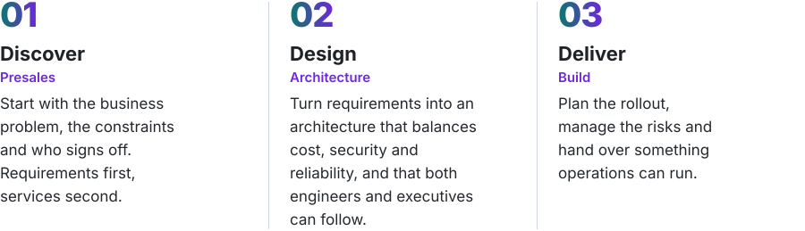

  

&nbsp;&nbsp;&nbsp;&nbsp;

<picture><source media="(prefers-color-scheme: dark)" srcset="./assets/headers/about-dark.svg"/></picture>

Hi, I'm Darrell, a Cloud & AI Solutions Architect at Lenovo PCCW Solutions in Singapore, designing and building on AWS, from LLM-backed applications to self-hosted model clusters, with the odd on-prem GPU build along the way.

I've worked across solution architecting, presales, cloud engineering and IT project management, and I've found my passion in solutioning and building. I'm always learning, whether it's new tech, the latest in AI or whatever's coming next.

On the side, I enjoy a good cup of coffee and I'm on permanent bulk mode.

 

<picture><source media="(prefers-color-scheme: dark)" srcset="./assets/headers/how-i-work-dark.svg"/></picture>

<picture><source media="(prefers-color-scheme: dark)" srcset="./assets/how-i-work-dark.svg"/></picture>

 

<picture><source media="(prefers-color-scheme: dark)" srcset="./assets/headers/stack-dark.svg"/></picture>

**Cloud & Infra**

  
  
  
  
  

**AI**

  
  
  
  

**Languages & Data**

  
  
  
  
  
  

 

<picture><source media="(prefers-color-scheme: dark)" srcset="./assets/headers/certifications-dark.svg"/></picture>

<picture><source media="(prefers-color-scheme: dark)" srcset="./assets/certifications-dark.svg"/></picture>

 
 

  

<code>imdarrell</code> was taken, so <code>itsdarrell</code> it is.

Always keen to hear what others are building. Up for a coffee chat? <a href="mailto:hello@imdarrell.com">Say hello.</a>

